<p align="center">
  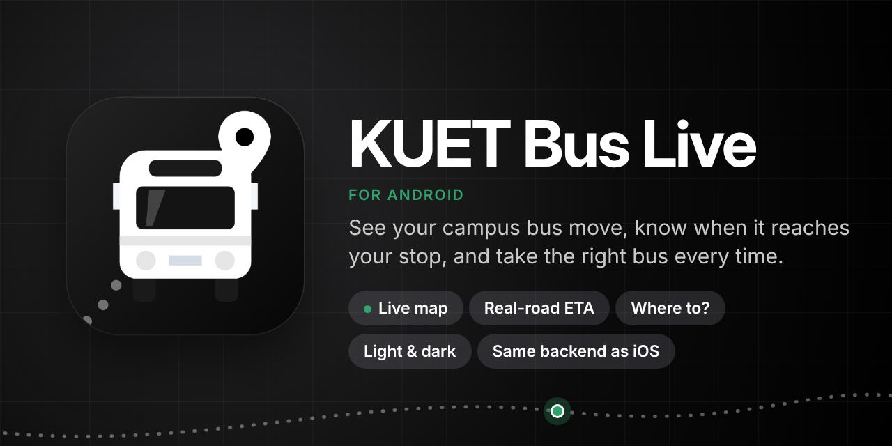
</p>

# KUET Bus Live for Android

[](https://github.com/shadowfax-505/KUETBusLive-Android/actions/workflows/android.yml)
[](https://github.com/shadowfax-505/KUETBusLive-Android/actions/workflows/screenshots.yml)


**See your campus bus move on a map, know exactly when it reaches your stop, and never chase the wrong bus again.**

This is the Android version of [KUET Bus Live](https://github.com/shadowfax-505/KUETBusLive), the live campus bus tracker for Khulna University of Engineering & Technology. It talks to the **same Firebase project and the same Firestore data** as the iPhone app, so a driver on an iPhone shows up on an Android rider's map, and the other way round.

**Author:** Muttakin Rahman Shoscho ([shadowfax-505](https://github.com/shadowfax-505))
**Course:** CSE 3218 Mobile Computing Lab, KUET (Open-Ended Project)

**Try it:** the latest build from `main` is always on the [android-demo release](https://github.com/shadowfax-505/KUETBusLive-Android/releases/tag/android-demo). Download `KUETBusLive-Android-demo.apk` on an Android phone and open it. New builds install over the old one.

---

## Contents

1. [Screenshots](#screenshots)
2. [What the app does](#what-the-app-does)
3. [Who uses it](#who-uses-it)
4. [The big picture](#the-big-picture)
5. [Live tracking, step by step](#live-tracking-step-by-step)
6. [How the ETA is worked out](#how-the-eta-is-worked-out)
7. [Where to wait, and where to get off](#where-to-wait-and-where-to-get-off)
8. [Design: an iPhone feel on Android](#design-an-iphone-feel-on-android)
9. [How the code is organised](#how-the-code-is-organised)
10. [Shared backend with iOS](#shared-backend-with-ios)
11. [Security](#security)
12. [Continuous integration](#continuous-integration)
13. [Setup](#setup)
14. [Credits](#credits)

---

## Screenshots

These are taken automatically by the [screenshot tour](#continuous-integration) on an Android emulator with made-up data. Every screen is shot twice, in light and in dark mode.

### Light mode

| Sign in | Live map | Bus selected | Where to get off |
| :-: | :-: | :-: | :-: |
| 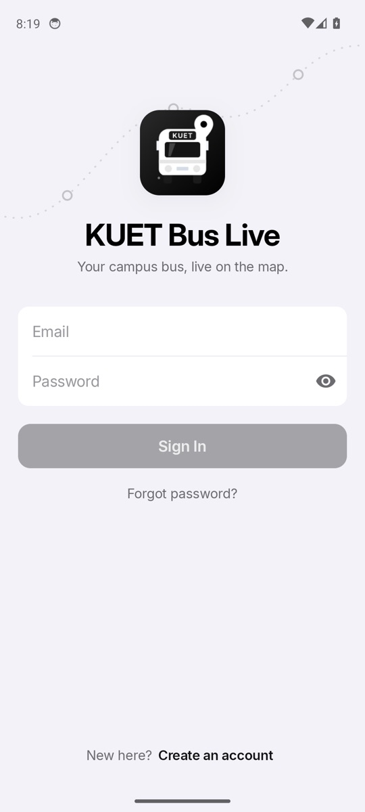 | 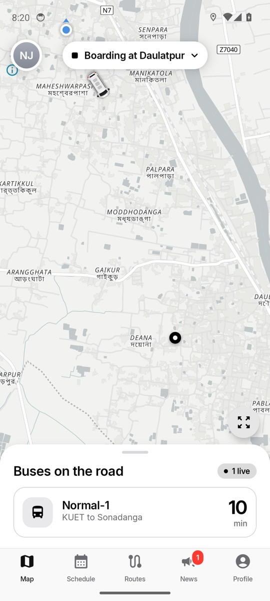 | 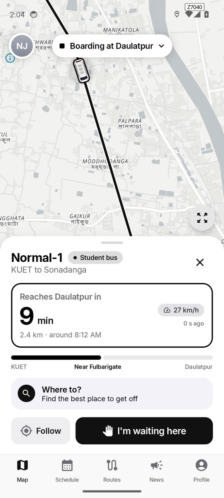 | 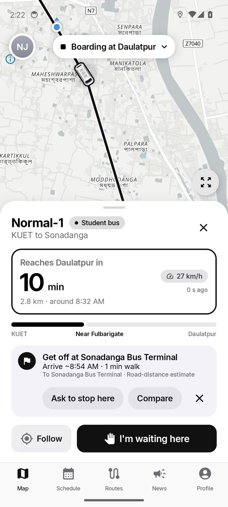 |

| Timetable | Routes | Profile | Driver |
| :-: | :-: | :-: | :-: |
| 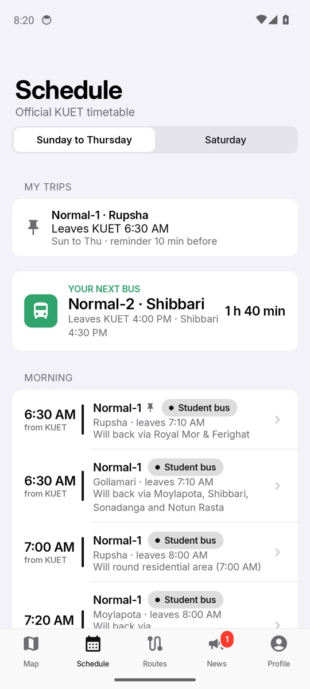 | 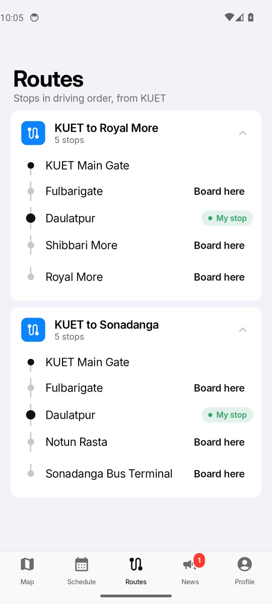 | 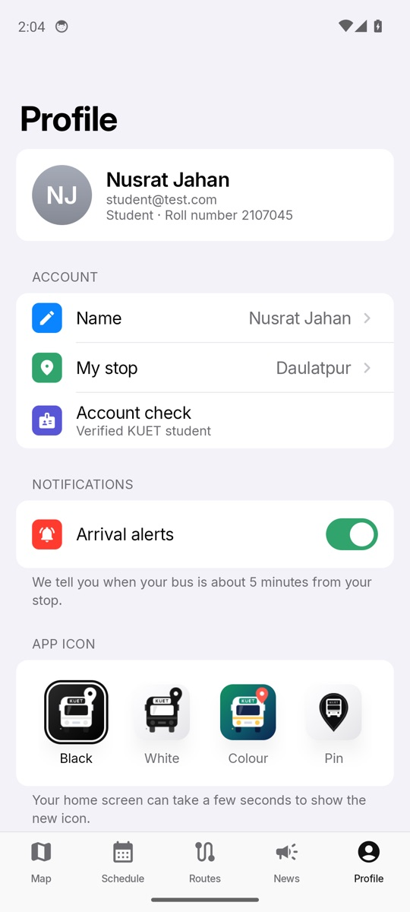 | 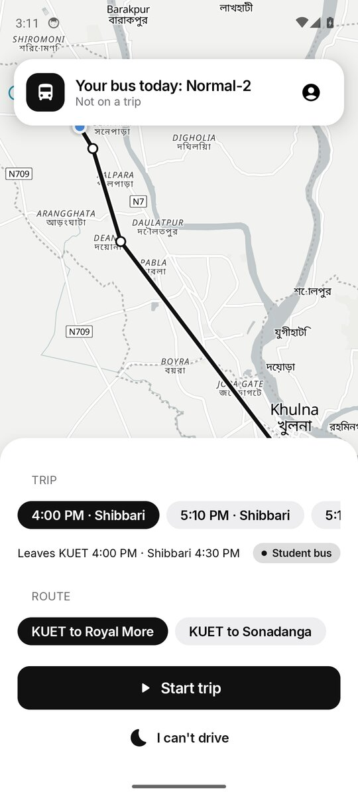 |

### Dark mode

| Sign up | Compare buses | News | Admin: approvals |
| :-: | :-: | :-: | :-: |
| 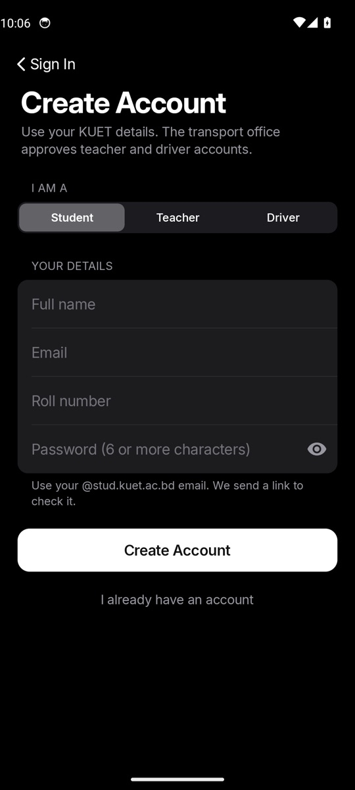 | 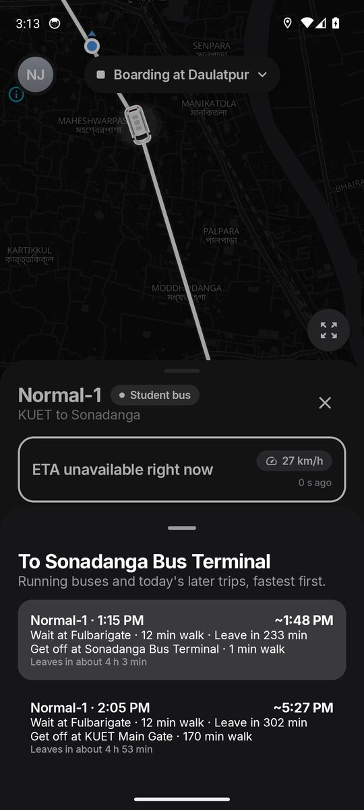 | 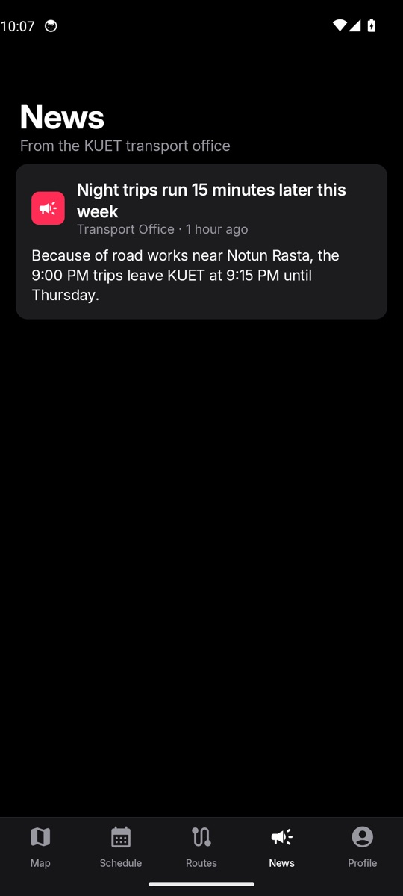 | 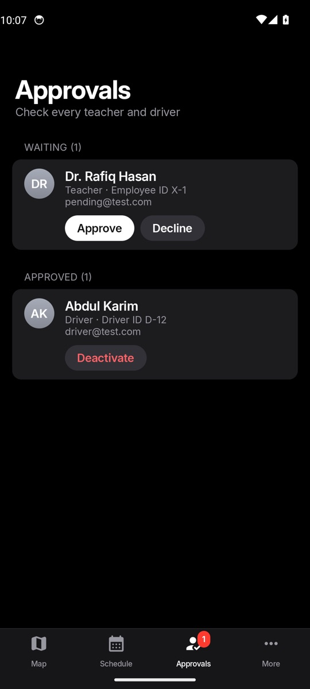 |

| Admin: map | Admin: more | Drivers & buses | Driver |
| :-: | :-: | :-: | :-: |
| 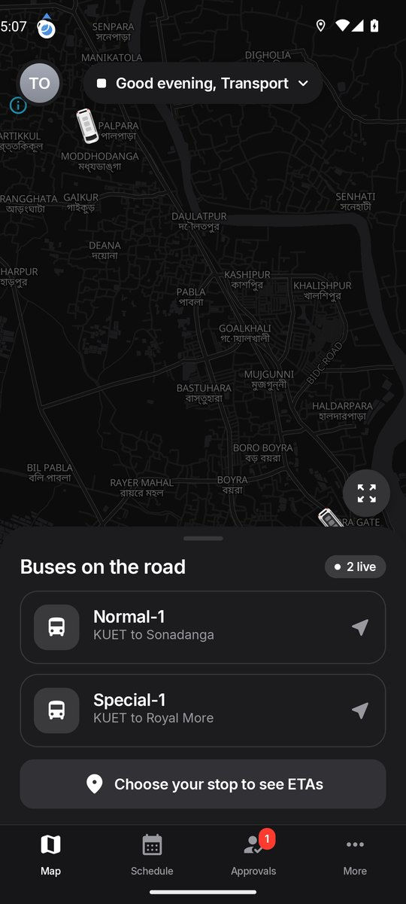 | 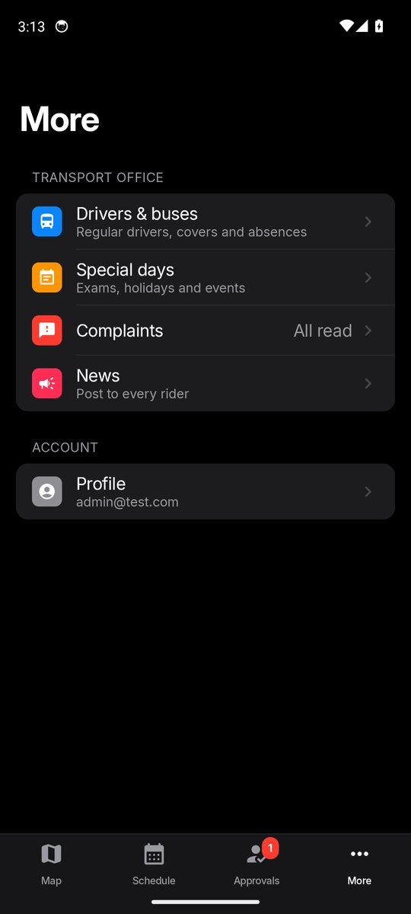 |  | 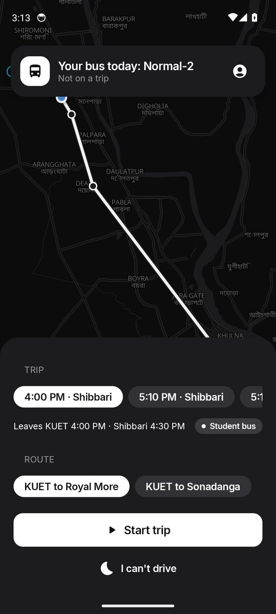 |

Every picture, in both modes, is in [`docs/screenshots`](docs/screenshots).

---

## What the app does

| Feature | In one line |
| --- | --- |
| 🗺️ Live map | Every running bus you may ride, drawn as a bus seen from above that glides between GPS fixes and turns with the road. |
| ⏱️ ETA to your stop | Minutes and distance to the stop you picked, over real roads, refreshed as the bus moves. |
| 📍 Where to? | Search any stop or place, and the app tells you the best stop to get off at and how long the walk is. |
| ⚖️ Compare | Every bus that can take you there today, fastest first. |
| ✋ I'm waiting here | Tell the driver you are waiting. They see you on the road ahead with a tone and a buzz. |
| 🛑 Ask to stop | Ask the driver to stop at the place that is best for you. |
| 🔔 Arrival alert | A notification when your bus is about 5 minutes from your stop. |
| 📅 Official timetable | All KUET trips (Sunday to Thursday and Saturday), with your next bus at the top. |
| 🎓 Bus allocation | Students see only *Normal* (student) buses. Teachers can ride any bus. |
| 👥 Crowd reports | Riders on the bus can say it is full, and everyone sees it. |
| 🪪 KUET ID check | Roll number or employee ID, KUET email, an email link, and admin approval for teachers and drivers. |
| 🛠️ Transport office | Edit the timetable, approve accounts, assign drivers, arrange covers, answer complaints and post news. |
| 🌗 Light and dark | Every screen, including the map, follows the phone's theme. |

---

## Who uses it

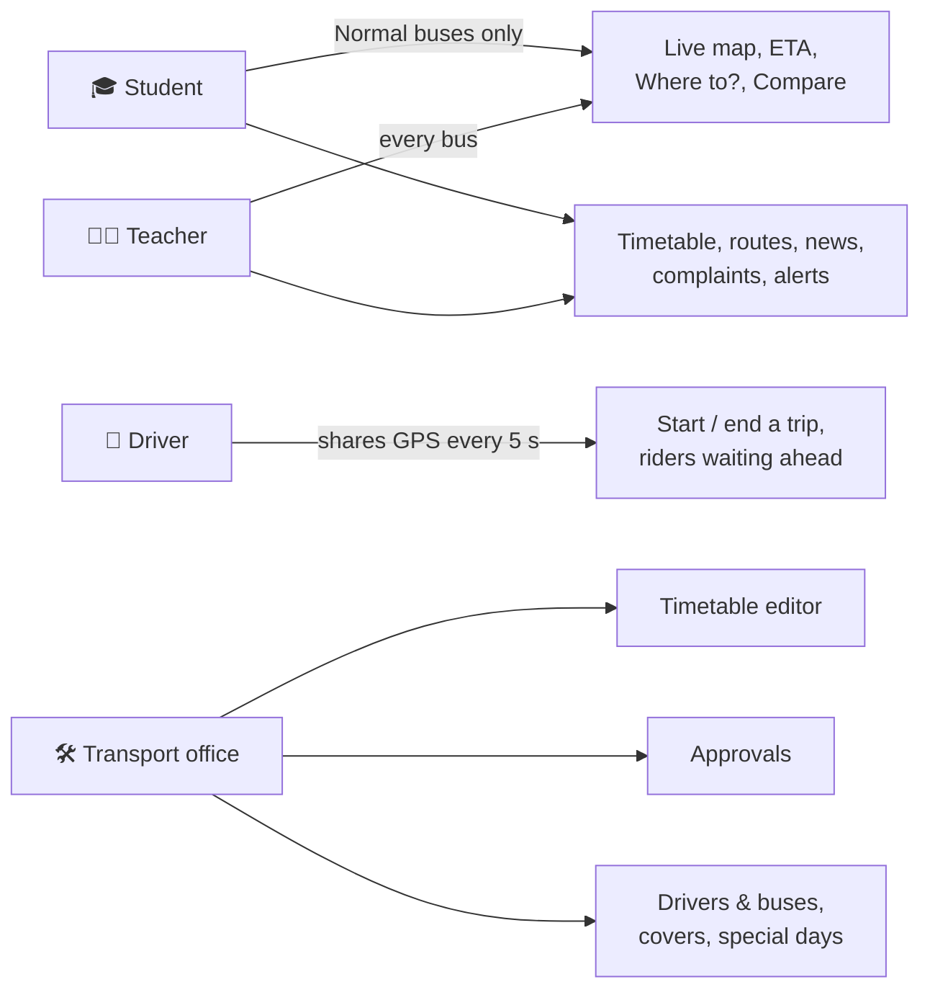

| Role | How they get in | What they see first |
| --- | --- | --- |
| **Student** | Roll number + `@stud.kuet.ac.bd` email + email link | The live map with student buses |
| **Teacher** | Employee ID + KUET staff email + email link + approval | The live map with every bus |
| **Driver** | Driver ID + approval | Today's bus, trips and a Start trip button |
| **Transport office** | Set up by the office in Firebase | Every bus on the map, then Schedule, Approvals and More |

---

## The big picture

Nothing runs on a server of my own. The driver's phone writes its position to Firestore, and every rider's phone listens.

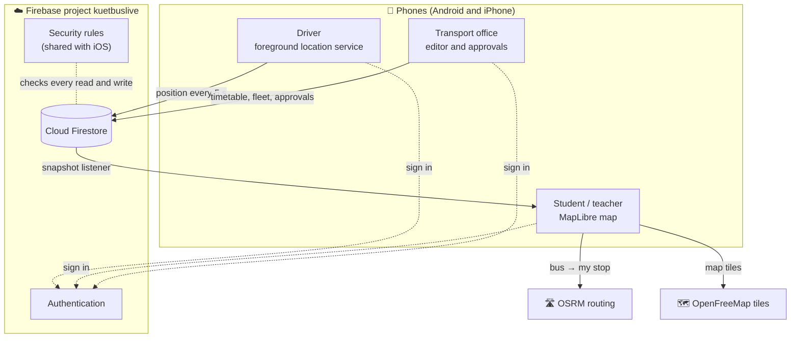

Firestore pushes every change to the phones that are listening, so nobody polls. A bus moving on the driver's phone shows up on everyone's map about a second later.

---

## Live tracking, step by step

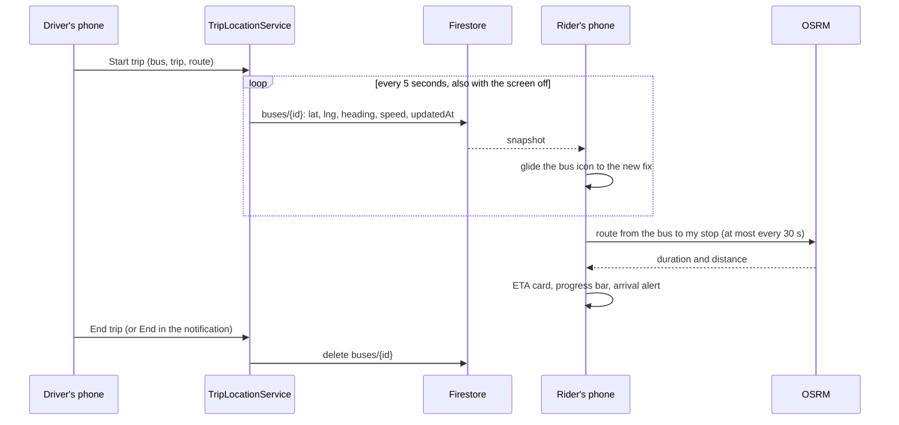

- The driver's position comes from a **foreground service** with a notification, so it keeps sending with the screen off. The notification has its own End trip button.
- Riders who say **"I'm waiting here"** write a small wave under the bus. The driver gets a large banner, a tone and a buzz while the rider is ahead on the road.
- A bus that has not sent a position for a while shows **Signal lost** with the time of the last fix, instead of pretending to be live.

---

## How the ETA is worked out

The app mixes two sources, the same way as the iOS app:

1. **OSRM** gives the driving time over real roads from the bus to your stop.
2. **What KUET buses actually did.** Every finished trip teaches the app how long each stretch between two stops takes, per time of day. The numbers are kept as running averages with a variance (`model/TravelModel.kt`), in the same Firestore documents the iOS app uses, so both apps learn from each other's trips.

When enough trips have been seen, the learned time leads and OSRM fills the gaps. The card says where the number comes from ("From 14 past trips" or "Road-distance estimate").

---

## Where to wait, and where to get off

Tap a bus and then **Where to?**, and pick a stop or search a place. The trip planner (`rider/TripPlanner.kt` and `model/CatchPoint.kt`):

- finds the **best stop to catch the bus**, given where you are and your own walking speed (learned on your phone from your walks),
- finds the **best stop to get off** for where you are going, and the walk from there,
- and with **Compare**, lists every running bus and later trip that can take you there, fastest first.

From the same card you can **ask the driver to stop** at that place.

---

## Design: an iPhone feel on Android

The Android app follows the look of the iOS app, not stock Material:

- **Colours** from the iOS app and iOS grouped lists: a light grey (or black) page, white (or dark grey) rows on top, grey secondary text and hairline separators. Near-black is the accent in light mode and white in dark mode, with green and red kept for meaning.
- **Type:** [Inter](https://rsms.me/inter/), sized like the iOS text styles (Large Title 34, Headline 17, Body 17, Footnote 13).
- **Pages** have a large title that folds into the top bar as you scroll, and a "‹ Back" control.
- **Lists** are inset grouped sections, like iPhone Settings, with coloured icon tiles.
- **Controls:** an iOS tab bar, segmented controls, green switches, capsule chips and buttons.
- **Dark mode** everywhere. The theme gives all text the right colour for the background, and the map switches to a dark style.

The pieces live in `ui/theme` and `ui/components`, so every screen uses the same parts.

---

## How the code is organised

Kotlin, Jetpack Compose with Material 3 underneath, one activity, and a ViewModel per area.

```
app/src/main/java/io/github/shadowfax505/kuetbuslive/
  model/      data model, timetable, KUET ID checks, bus assignment,
              learned travel times, trip planner maths (unit tested)
  data/       Firestore reads and writes, OSRM client, learned stats, local settings
  map/        MapLibre map, bus icons, smooth bus movement
  auth/       sign in, sign up, email check, waiting for approval
  rider/      live map, trip card, Where to?, Compare, arrival alerts
  driver/     trip screen, foreground location service, trip learning
  admin/      approvals, drivers & buses, complaints inbox, special days
  campus/     routes, news, complaints, profile, stop picker
  schedule/   timetable and its editor
  ui/         theme, shared components, the home screen for each role
```

| Library | Used for |
| --- | --- |
| Jetpack Compose, Material 3 | every screen |
| Firebase Auth, Cloud Firestore | accounts and live data |
| MapLibre Native + OpenFreeMap | vector map, light and dark styles, no API key |
| OSRM | road routes and driving times |
| Android Geocoder | searching places for Where to? |
| Play Services Location | GPS for drivers and riders |

---

## Shared backend with iOS

Both apps follow [`docs/data-model.md`](https://github.com/shadowfax-505/KUETBusLive/blob/main/docs/data-model.md) and the [`firestore.rules`](https://github.com/shadowfax-505/KUETBusLive/blob/main/firestore.rules) kept in the iOS repository. Nothing on the server changes for Android.

| Collection | Used for |
| --- | --- |
| `users` | profiles, roles, approval, favourite stop |
| `schedules`, `routes`, `specialDays` | timetable, stops, exam days and holidays |
| `buses` (+ `waves`) | live trips and riders waiting |
| `fleet`, `driverAbsences`, `trips` | who drives which bus, covers and per-trip drivers |
| `segmentStats`, `spotStats`, `driverStats`, `dropoffs` | learned travel times |
| `complaints`, `announcements` | feedback and news |

---

## Security

- The **rules** decide who may do what. A driver can only put the bus they drive today on the map, and only change its position. Students can only read student buses, so the app asks for exactly those.
- **Students and teachers must confirm their KUET email** before they get in. Teachers and drivers also wait for the transport office.
- **Demo accounts** (`@test.com`) work only in debug builds, the same as on iOS. Release builds accept KUET emails only.
- `google-services.json` is **never committed**. CI writes it from a repository secret.

---

## Continuous integration

Two GitHub Actions workflows:

| Workflow | When | What it does |
| --- | --- | --- |
| [Android CI](.github/workflows/android.yml) | every push | Runs the unit tests (KUET ID checks, timetable, maths, bus assignment, trip learning) and builds the APK. On `main` it publishes the APK to the [android-demo release](https://github.com/shadowfax-505/KUETBusLive-Android/releases/tag/android-demo). |
| [Screenshots](.github/workflows/screenshots.yml) | push to `screenshots` | Starts the Firebase emulators with made-up accounts, buses and the real timetable, runs `ShowcaseTest` on an Android emulator through every role in light and dark mode, and saves the pictures. It never touches the real project. |

---

## Setup

1. Open the `kuetbuslive` project in the [Firebase console](https://console.firebase.google.com/).
2. Add an Android app with the package name `io.github.shadowfax505.kuetbuslive`.
3. Download `google-services.json` into `app/`. Git ignores it.
4. Open the project in Android Studio and run it on a phone or emulator with Android 8.0 or newer.

Without `google-services.json` the app still builds, and opens on a short screen that says the file is missing.

```
./gradlew testDebugUnitTest assembleDebug
```

---

## Credits

- Map data © [OpenStreetMap](https://www.openstreetmap.org/copyright) contributors, tiles by [OpenFreeMap](https://openfreemap.org).
- Routing by [OSRM](https://project-osrm.org).
- [Inter](https://rsms.me/inter/) by Rasmus Andersson, under the SIL Open Font License ([`docs/licenses/Inter-OFL.txt`](docs/licenses/Inter-OFL.txt)).

Made by Muttakin Rahman Shoscho ([@shadowfax-505](https://github.com/shadowfax-505)) for CSE 3218 Mobile Computing Lab, KUET.
